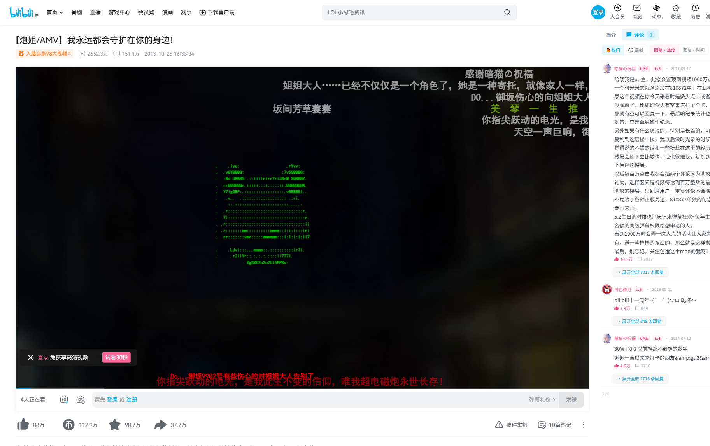

# Bili Comments Sidebar / B站评论侧栏

一个 Edge/Chrome 扩展（Manifest V3），为 Bilibili 视频页面提供左视频、右评论栏的双栏浏览体验。



## 功能特性

- **双栏布局** — 视频在左，评论/简介栏在右（默认进入 简介 页）
- **评论·简介切换** — 标签行一键切换：评论 = 本扩展的评论栏；简介 = B站原生右栏（相关视频/UP主卡片）
- **时间戳跳转** — 评论中的 03:25 等时间自动变为可点击，主播放器 seek 并播放
- **评论超链接** — 评论里的裸 URL（http/https）自动变成可点击链接，新标签页打开
- **头像 / 用户名 / @ 跳转** — 点击评论者头像或用户名跳转其个人空间；@ 提及高亮可点击（B站品牌蓝 #00aeec）
- **排序** — 评论「热门/最新」；楼中楼「回复·热度/回复·时间」（客户端重排）
- **搜索/高亮** — 顶部搜索框过滤评论并高亮命中
- **无限滚动** — 评论列表内部滚动到底自动加载更多
- **回复展开** — 展开完整回复楼层（Reddit 风格缩进线）
- **UP主标记 / 等级标签 / B站表情 / 图片评论**
- **SPA 适配** — 站内切换视频自动刷新评论并回到默认标签
- **默认标签设置** — 标签行右侧 💬 按钮切换「新视频默认打开评论」
- **原生评论区保留** — B站播放器下方的原生评论区原样显示，与右栏互不干扰

## 安装

1. 从 [Releases](https://github.com/coffee0224/bili-comments-sidebar/releases) 下载最新版 `bili-comments-sidebar-vX.Y.Z.zip` 并解压到本地（任意固定位置，安装后不要删除）。
2. 打开 `edge://extensions`（Edge）或 `chrome://extensions`（Chrome），开启「开发人员模式」。
3. 点击「加载解压缩的扩展」，选择解压出的文件夹。
4. 若装过商店版 Bili Comments Sidebar，先停用它（避免双份注入）。
5. 打开任意 B站 视频页即可。升级版本时：下载新版 zip 覆盖解压目录 → 扩展页点「重新加载」→ F5 刷新已打开的视频页。底部版本徽标可确认新脚本已生效。

> 开发者：直接 clone 本仓库，同上以仓库目录「加载解压缩」即可；改码后在扩展页点「重新加载」。

## 使用说明

| 操作 | 方式 |
|------|------|
| 切换 评论/简介 | 右栏顶部标签行「简介 / 评论 N」 |
| 切换排序 | 顶部「热门」/「最新」 |
| 刷新评论 | 工具栏刷新按钮 |
| 加载更多 | 评论列表内滚动到底自动加载 |
| 时间戳跳转 | 点击评论里的 mm:ss |
| 打开评论里的链接 | 点击 URL，新标签页打开 |
| 跳转用户主页 | 点击评论者头像 / 用户名 / @ 提及 |
| 回到顶部 | 列表底部「⬆ 回到顶部」 |
| 新视频默认标签 | 标签行右侧 💬 按钮：点亮 = 直接进评论页 |

## 开发

```bash
npm test      # node --test （需要 Node 18+）
npm run check # node --check lib.js content.js
```

纯逻辑在 `lib.js`（有单元测试），DOM 层在 `content.js`，样式在 `sidebar.css`。

## 致谢

基于商店版 [Bili Comments Sidebar](https://chromewebstore.google.com/detail/bili-comments-sidebar/lepfkokibljdknhnmhokknpfkibckblm) 1.3.0 的本地 fork，重构并扩展。
